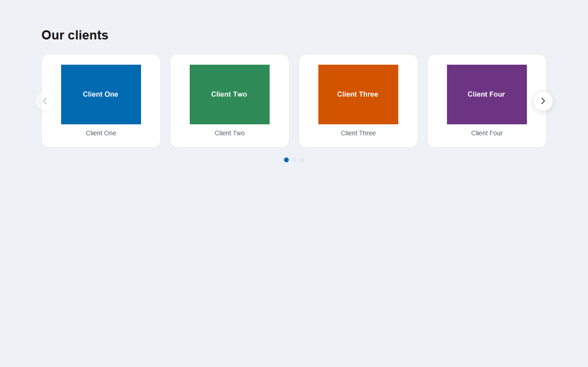

# Our clients

Модуль для Drupal 9.3+ / 10 / 11, добавляющий настраиваемый блок **«Наши клиенты»** — слайдер с картинками клиентов и их названиями. При клике на слайд открывается **модальное окно** с увеличенным изображением, описанием клиента и его отзывом. Слайдом может быть не только изображение, но и **видео** — загруженный файл или ролик с YouTube/VK/другого провайдера: в слайдере показывается автоматическое превью, в модальном окне видео проигрывается.

Внешний вид слайдера и все его содержимое настраиваются в админ-разделе модуля: заголовок блока, количество видимых слайдов, автопрокрутка, цвета кнопки «Подробнее» и отзывов, а также добавление/редактирование/сортировка слайдов (картинка, alt-текст, название, описание, отзыв).

[Read this documentation in English](./README.en.md)



## Возможности

- **Блок `Our clients slider`** — размещается в любом регионе темы через стандартную страницу «Схема блоков»
- **Слайдер без внешних библиотек** — чистый vanilla JS (~12 КБ): стрелки, свайп мышью и пальцем, автопрокрутка с паузой при наведении. Дизайн — в духе блока «Наши клиенты» на stormoff.ru: заголовок в стиле h2 темы сайта, фотокарточки без рамок, название клиента и акцентная кнопка «Подробнее»
- **Модальное окно** — клик по слайду открывает карточку клиента: большое изображение (или плеер с видео), описание и **отзывы клиентов** — оценка звёздами, цитата, автор, город и дата. Закрытие — крестиком, кликом мимо окна или клавишей Esc
- **Полноценная админка** (раздел «Управление » Структура » Наши клиенты»):
  - Список слайдов с миниатюрами и **drag & drop сортировкой**
  - Форма слайда: поле **«Медиа-изображение»** (свёрнуто по умолчанию, чтобы список медиа не занимал весь экран) — выбор существующего медиа-объекта из сетки с превью или загрузка нового файла (автоматически сохраняется как медиа-объект), название клиента, описание (текстовый формат), **отзывы** (множественное поле: имя автора, дата, город, оценка 1–5, текст отзыва — добавляйте сколько нужно кнопкой «Добавить отзыв»), публикация
  - Вкладка «Настройки»: заголовок блока, число видимых слайдов (десктоп / планшет / мобильный), автопрокрутка и её интервал, размеры: максимальная ширина слайдера, высота картинок в слайдах (десктоп и мобильный), размер названия клиента и **отступы вокруг него**, ширина модального окна, а также **размер и отступы заголовка**, **полная стилизация кнопки «Подробнее»** (цвет текста, цвет текста при наведении, фон, фон при наведении, скругление, размер шрифта, высота и горизонтальный отступ — десктоп и мобильный) и **цвет отзывов** (звёзды, рамка и фон отзывов в модальном окне)
- **Мобильная адаптация** — отдельные значения количества слайдов и высоты картинок для мобильных, свайп-навигация пальцем, компактные стрелки
- **Доступность** — ARIA-атрибуты карусели, управление стрелками с клавиатуры, фокус-ловушка в модальном окне, поддержка `prefers-reduced-motion`
- **Медиатека и видео** — изображение или видео слайда хранится как медиа-объект: файлы не дублируются, один медиа-объект можно переиспользовать; поддерживаются медиа-типы с источниками «изображение», «видео» и oEmbed (YouTube, VK и другие настроенные на сайте провайдеры); alt-текст задаётся у медиа-объекта
- **Автоматические image-стили** — `our_clients_slider` (480x360, без апскейла) и `our_clients_modal` (до 1200px) создаются при установке
- **File usage tracking** — картинки слайдов защищены от сборки мусора и автоматически освобождаются при замене/удалении слайда
- **Кэширование** — блок обновляется при изменении любого слайда или настроек; при пустом списке анонимным посетителям блок не показывается вовсе, а администратору выводится подсказка со ссылкой в админку
- **Русская локализация в комплекте** — интерфейс автоматически переводится на русский на сайтах с русским языком
- **Совместимость** — Drupal 9.3.x, 10.x, 11.x; jQuery не требуется

## Требования

- Drupal 9.3+ / 10 / 11
- PHP в соответствии с требованиями вашей версии Drupal

Модуль использует только **Media** (входит в ядро Drupal) — Media Library и дополнительные contrib-модули не требуются: выбор из медиатеки встроен в форму слайда. Изображение слайда хранится как медиа-объект и переиспользуется без дублирования файлов.

## Установка

### Вариант 1: через Composer (рекомендуется)

1. Добавьте репозиторий модуля в конфигурацию Composer вашего проекта (команда ниже — всё редактирование `composer.json` выполняется автоматически):

   ```bash
   composer config repositories.our-clients vcs https://github.com/Mmitekk/DrupalOurClients.git
   ```

2. Установите модуль:

   ```bash
   composer require mmitekk/our-clients:^1.0
   ```

   Composer скачает стабильный релиз и положит модуль в `modules/custom/our-clients/` (или `web/modules/custom/our-clients/` — путь зависит от структуры вашего проекта).

3. Включите модуль:

   ```bash
   drush en our_clients -y
   ```

   или через админку: **Управление » Расширение** (`/admin/modules`), найдите «Our clients» и отметьте галочкой.

4. Сбросьте кэш:

   ```bash
   drush cr
   ```

**Обновление модуля:**

```bash
composer update mmitekk/our-clients
drush updb -y
drush cr
```

> **Примечание:** если в вашем проекте нет кастомных installer-paths, Composer установит модуль по пути, определенному в `installer-paths` проекта. Убедитесь, что итоговая папка находится внутри директории модулей Drupal и содержит файл `our_clients.info.yml`.

### Вариант 2: вручную

1. Скачайте архив актуального релиза со страницы [Releases](https://github.com/Mmitekk/DrupalOurClients/releases) (файл `our_clients-X.Y.Z.zip`).
2. Распакуйте архив — внутри папка `our_clients`.
3. Скопируйте её в `modules/custom/` вашего сайта: получится `modules/custom/our_clients/our_clients.info.yml`.
4. Включите модуль на странице **Управление » Расширение** и сбросьте кэш.

## Быстрый старт

1. Откройте **Управление » Структура » Наши клиенты** (`/admin/structure/our-clients`).
2. Нажмите **«Добавить слайд»**: в поле «Медиа-изображение» выберите существующий медиа-объект из сетки с превью или загрузите новый файл, укажите название клиента, описание и отзыв, сохраните. Повторите для остальных клиентов.
3. При желании зайдите на вкладку **«Настройки»** и задайте заголовок блока (по умолчанию «Our clients»), количество видимых слайдов и при необходимости цвета кнопки «Подробнее» и отзывов.
4. Разместите блок: **Управление » Структура » Схема блоков** (`/admin/structure/block`) » выберите регион » **«Разместить блок»** » найдите **«Слайдер «Наши клиенты» / Our clients slider»**.
5. В форме размещения при необходимости скройте служебное название блока (галочка «Показывать название блока»), если заголовок уже задан в настройках модуля, — иначе заголовок выведется дважды.
6. Сохраните и посмотрите на любую страницу региона.

## Админка модуля

| Раздел | Путь | Что настраивается |
|---|---|---|
| Слайды | `/admin/structure/our-clients` | Список слайдов, drag & drop сортировка, кнопка «Добавить слайд», операции «Изменить»/«Удалить» |
| Форма слайда | `/admin/structure/our-clients/add` | Медиа-изображение (выбор из медиатеки или загрузка), название клиента, описание, отзывы (множественное поле: автор, дата, город, оценка, текст), публикация |
| Настройки | `/admin/structure/our-clients/settings` | Заголовок блока, видимые слайды (3 брейкпоинта), автопрокрутка, интервал, размеры (ширина слайдера, высота картинок, размер названия клиента и отступы вокруг него, ширина модалки), размер и отступы заголовка, стиль кнопки «Подробнее» (цвет текста и при наведении, фон, скругление, размеры), цвет отзывов |

Ссылка на раздел также есть в админ-меню: **Управление » Структура » Наши клиенты**.

Права: за управление разделом отвечает разрешение **«Administer Our clients»** (по умолчанию доступно администратору).

## Темизация

Блок стилизуется через CSS-переменные — их можно переопределить в теме сайта, не трогая файлы модуля (часть переменных также дублируется в настройках модуля):

```css
.our-clients {
  --oc-max-width: 1200px;            /* макс. ширина слайдера (есть в настройках) */
  --oc-image-height: 390px;          /* высота картинки в слайде (есть в настройках) */
  --oc-image-height-mobile: 200px;   /* высота картинки на мобильном (есть в настройках) */
  --oc-name-size: 24px;              /* размер названия клиента (есть в настройках) */
  --oc-name-margin-top: 15px;        /* отступ над названием клиента (есть в настройках) */
  --oc-name-margin-bottom: 0;        /* отступ под названием клиента (есть в настройках) */
  --oc-heading-font-size: inherit;   /* размер заголовка (есть в настройках) */
  --oc-heading-margin-top: 0;        /* отступ заголовка сверху (есть в настройках) */
  --oc-heading-margin-bottom: 32px;  /* отступ заголовка снизу (есть в настройках) */
  --oc-more-color: #ff5073;          /* цвет текста кнопки «Подробнее» (есть в настройках) */
  --oc-more-hover-color: #ff5073;    /* цвет текста кнопки при наведении (есть в настройках) */
  --oc-more-bg: #ffffff;             /* фон кнопки (есть в настройках) */
  --oc-more-bg-hover: rgba(255, 80, 115, 0.08); /* фон кнопки при наведении (есть в настройках) */
  --oc-more-radius: 40px;            /* скругление кнопки (есть в настройках) */
  --oc-more-font-size: 18px;         /* размер шрифта кнопки (есть в настройках) */
  --oc-more-height: 40px;            /* высота кнопки (есть в настройках) */
  --oc-more-padding-x: 24px;         /* горизонтальный отступ кнопки (есть в настройках) */
  --oc-review-color: #ff5073;        /* цвет отзывов в модальном окне (есть в настройках) */
  --oc-text: #000000;                /* текст модального окна */
  --oc-text-muted: #5b6470;          /* описания и подписи */
  --oc-bg: #ffffff;                  /* фон модального окна */
  --oc-surface: #f5f7fa;             /* фон картинки в модальном окне */
}
```

Заголовок блока выводится как `h2` и **по умолчанию полностью наследует стиль заголовков h2 темы сайта** (цвет, шрифт, размер). Размер и отступы заголовка, отступы названия клиента, стиль кнопки «Подробнее» и цвет отзывов можно переопределить в админке (вкладка «Настройки»); пустые значения оставляют поведение по умолчанию.

На обёртке блока стоят классы макета темы `page-content page-margin-top-middle page-margin-bottom-middle page-padding-top-big page-padding-bottom-middle` — при необходимости поменяйте их в шаблоне. Надпись кнопки «Подробнее» переводится как обычная строка интерфейса.

Шаблон по умолчанию: `templates/our-clients-slider.html.twig` — скопируйте его в папку `templates` своей темы для переопределения (кэш темы сбросить после этого).

Модальное окно (`oc-modal__*`) добавляется прямо в `<body>`; переменные блока (цвет отзывов и т. п.) копируются в него скриптом, остальные CSS-переменные имеют фолбэки.

## Частые вопросы

**Слайдер не показывается на странице.**
Проверьте: (1) в блоке есть хотя бы один **опубликованный** слайд — пустой блок полностью скрывается; (2) блок размещен в регион темы, который реально выводится на этой странице; (3) сброшен ли кэш (`drush cr`).

**Картинки не отображаются / битые превью.**
Сбросьте кэш — image-стили генерируются при первом обращении. Убедитесь, что к слайду привязан медиа-объект с изображением (поле «Изображение» обязательное) и что у медиа-объекта заполнен alt-текст.

**Как убрать автопрокрутку?**
Вкладка «Настройки» » снять галочку «Автопрокрутка» » сохранить.

**Как переименовать заголовок «Наши клиенты»?**
Вкладка «Настройки» » поле «Заголовок блока» (очистите, чтобы слайдер был без заголовка). Служебное название самого блока меняется в форме его размещения на странице «Схема блоков».

**Как задать alt-текст картинке?**
При загрузке нового файла alt автоматически равен названию клиента. Изменить его можно у медиа-объекта: /admin/content/media » изменить » поле «Alt». Если alt пуст, в качестве alt используется название клиента.

**Надписи в админке модуля на английском.**
Если на сайте включен русский язык интерфейса, модуль сам импортирует свой русский перевод при первом открытии своих админ-страниц — обновите страницу ещё раз. Ручной вариант: /admin/config/regional/translate/import » файл `translations/our_clients.ru.po` из папки модуля.

**В админке английский язык.**
Убедитесь, что на сайте включен модуль **Interface Translation** (`locale`) и язык интерфейса — русский: перевод из папки `translations/` импортируется автоматически при установке модуля. При необходимости: **Управление » Конфигурация » Региональные настройки » Перевод интерфейса » Обновить** (`/admin/config/regional/translate/import`).

**На Drupal 9 `composer require drupal/media_library_form_element` падает с ошибкой.**
Этот contrib-модуль больше **не нужен** — с версии 1.3.0 наш модуль не зависит от него (поле выбора медиа реализовано внутри самого модуля, из зависимостей только ядровый `media`). Пакет `media_library_form_element` 2.x требует Drupal 10.3+, поэтому Composer отказывается ставить его на 9.5. Ничего дополнительно устанавливать не надо: просто обновите сам модуль до актуальной версии (`composer update mmitekk/our-clients` или замените файлы вручную) и выполните `drush updb -y && drush cr` — если старый contrib-модуль был включён, обновление само его отключит. Модуль совместим с Drupal 9.3+ и PHP 7.4.

**После обновления модуля сайт упал с ошибкой «The "paragraph" entity type did not specify a translation handler».**
Это известный баг ядра Drupal 9.5/10 (drupal.org issue #3207813, исправлен только в Drupal 11): при операциях с модулями кэш может сохраниться повреждённым, и связка Paragraphs + Content Translation падает. Модуль «Наши клиенты» здесь ни при чём — так может упасть любая операция с модулями или очисткой кэша. Лечится очисткой кэша: `drush cr` (при необходимости дважды). Если и drush падает с той же ошибкой, очистите кэш напрямую в БД: `drush sqlq "TRUNCATE cache_bootstrap; TRUNCATE cache_discovery; TRUNCATE cache_entity; TRUNCATE cache_default; TRUNCATE cache_data;"`, затем `drush cr`.

## Лицензия

[GPL-2.0-or-later](LICENSE.txt)
